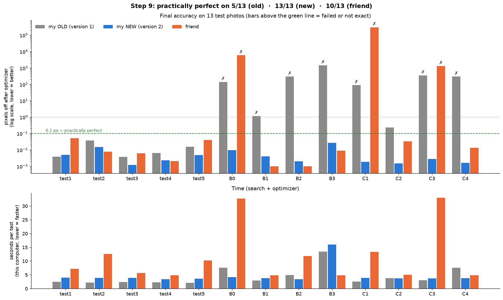

# Improvements – Version 2 of My Method (after comparing with my friend)

Changed files: `step4_find_shift.py` (big change), `step6_optimizer.py` (small change).
Test: `step9_old_vs_new.py` (this script is in the git history – it needed my friend's code, which is not in this final version); results kept: `results/step9_results.json`,
`results/step9_old_vs_new.png`, new test photos `images/generated/B0_…`, `C1_…`–`C4_…`.
In the final folder only version 2 is left. Version 1 and the comparison scripts
(Steps 8 and 9) are in the git history. The hard tests now run with `step7_hard_tests.py`.

---

## 1. The result in one picture



13 test photos (my 5 + 8 harder ones with big shifts, zoom up to ×3 and the paper's stretch):

| | Old (version 1) | **New (version 2)** | Friend |
|---|---|---|---|
| Practically perfect (< 0.1 px after optimizer) | 5 / 13 | **13 / 13** | 10 / 13 |
| Worst result | failed (1449 px) | **0.044 px** | failed (304,173 px) |
| Search time per test (cloud computer) | 4.1 s | 8.4 s | 11.3 s |
| Search time per test (**my MacBook Air**, Step 4) | 1.7 s | 2.6–3.2 s | ~4.3 s |
| Search + optimizer, average of 13 tests (**my Mac**) | 4.4 s | 4.7 s | 11.6 s |

**New version = the only one that works on all 13.** Price: the search is about 2× slower than
my old one (but still faster than my friend's).

---

## 2. Everything I changed (simple words)

### Change A – Search the WHOLE picture, not a ±60 px box (idea from my friend)
**Before:** I only looked for the matching spot near the middle of the original.
**Now:** every spot of the original is checked.
**Example:** looking for your friend in a crowd photo – before, I only checked the faces near
the middle; now I check every face.
**Why it matters:** B2, B3, C1–C4 have shifts of 90–190 px. The old version failed on all of them.

### Change B – Rough search on a 4× smaller copy, then exact search (fast)
Checking all ~260,000 pixels at full size would take minutes. So:
1. Make both photos 4× smaller → only ~16,000 spots, with a small clock picture (90 × 64).
2. Keep a short list of the best spots.
3. Check every pixel ±5 px around each short-listed spot with a half-size clock picture (180 × 128).
4. Final check ±1 px with the full clock picture (360 × 256) → exact turn and zoom.

**Example:** Google Maps: first look at the whole country, then zoom into the city, then the street.
Also: the 16,000 rough checks are computed in batches with SciPy's fast Fourier transform
(10× faster than NumPy's on this computer).

### Change C – Two "judges" make the short list (my friend's + mine combined)
I found that in the rough search **each method alone failed on some photos:**
- **Phase correlation (mine):** gives one very sharp "needle" at the right spot – very exact –
  but is also excited by the smooth sky and the photo's edges (stripes in the bottom row of
  `results/step4_search_maps.png`). B2's true spot ranked only ~2000th!
- **Cross-correlation (friend's, like the paper):** gives gentle "hills", not fooled by the sky,
  but less sharp. It missed B1 and B3.

**Now:** each judge proposes its 6 best spots → 12 candidates → the exact phase correlation
at full size picks the winner.
**Example:** two teachers each pick their 6 best students; then one hard exam decides the winner.
Each teacher alone sometimes forgets the best student, but together they never did.

### Change D – Fill black corners and outside the picture with average gray
**Before:** outside = black. The sharp black/photo border made fake matches
("the picture frame matches the black corners of the test photo").
**Now:** outside areas are average gray (soft, no fake edges), plus a 200 px gray frame.

### Change E – Two anchors + a "really matches?" check
**Anchor** = the standing spot in the test photo that we look for in the original.
**Before:** always the middle of the test photo. **Problem:** in B3 the middle is in the empty
sky → hard to find (optimizer only reached ~1 px).
**Now:** try two anchors: **the middle** and **the spot with the most detail** (strongest edges).
Then, for each answer, put the test photo back (like Step 5) and measure how well it **really**
matches the original (correlation of brightness, 1 = perfect). The better answer wins.
**Why two, not just "most detail"?** I tried "most detail" alone: it broke B1 and C1, because
the most detailed spot was often rows of building windows that look the same everywhere
(like looking for one window in a wall of identical windows).
The shift formula changed a little: `shift = anchor − middle − L·(spot − middle)`
(before, anchor = middle).

### Change F – Optimizer: blurrier start (idea from my friend)
**Before:** blur 2 → 1. **Now:** blur 4 → 2 → 1 → 0.5.
**Example:** walking downhill blindfolded – with a very blurry photo the hill is smooth and wide,
so you don't get stuck in a small hole on the way. Then sharper photos for the exact bottom.
B1 (stretched test): 1.15 px → **0.003 px**.

---

## 3. Mistakes I made on the way (and fixed) – good for the report
1. **Rough search on small photos with phase correlation alone** → B2 failed (sky beat buildings). → Change C.
2. **Gray fill alone** did not fix B2 → it was not the edges, it was the "needle vs hills" problem.
3. **"Most detail" anchor alone** → B1, C1 broke (repeating windows) → Change E (two anchors + check).
4. **Second anchor skipped** if within 30 px of the middle → test4 failed. → always try both.
5. **Exact search ±4 px** too small for test4 (true spot 5–6 px from the rough guess) → ±5 px.
6. **Exact search every 2nd pixel** (to save time) → C1 (zoom ×3) failed: the needle is only
   1 px wide at big zoom (1 px in the original = 3 px in the test photo). → every pixel with
   half-size clock pictures (cheaper but still every pixel).

---

## 4. Old vs new on my own 5 tests

| Test | Old: after Step 4 → Step 6 | New: after Step 4 → Step 6 |
|---|---|---|
| test1 | 0.01 → 0.003 px | 0.39 → 0.006 px |
| test2 | 0.64 → 0.037 px | 1.22 → 0.015 px |
| test3 | 0.93 → 0.004 px | 0.81 → 0.001 px |
| test4 | 2.04 → 0.006 px | 1.66 → 0.002 px |
| test5 | 0.56 → 0.016 px | 0.45 → 0.005 px |

(Your normal pipeline, `step4` → `step5` → `step6`, now gives 0.00–0.02 px on all 5.)
Honest note: on the easy tests test1/test2 the **new search alone is a little less exact**
(gray fill changes the clock picture a bit). After the optimizer the new version is as good
or better on all 5.

---

## 5. Did I do it right? – My method vs the paper

| Paper (Wolberg & Zokai) | My version 2 | Same / better / worse |
|---|---|---|
| Two parts: log-polar for a rough guess, then Levenberg–Marquardt for the exact answer | Same two parts | ✅ same |
| Log-polar of the center of the reference photo; try **every position** of the other photo | Anchor in the TEST photo, try **every position** of the original (reverse direction) | ✅ same idea; reverse direction is a **plus** (see below) |
| Cross-correlation finds the slide | Cross-correlation (rough) + phase correlation (exact) + sub-pixel | ⬆ improvement |
| Image pyramid to make the search fast | 3 levels: 4× smaller copy → half-size clock → full clock | ✅ same idea |
| LM on 6 affine numbers (a1–a6), SSD | Same (`least_squares(method="lm")`, SSD) | ✅ same |
| LM uses a pyramid (coarse → fine) | Blur 4 → 2 → 1 → 0.5 | ✅ same idea |
| Correction by LM is close to "do nothing" | Yes, e.g. test4 `[1.016 −0.002 −3.2 / 0.002 1.016 −5.8]` | ✅ same |
| LM alone fails for big changes | Yes: start from "no change" → test1 42 px, test4 15,058 px, B1 285 px, C2 150 px off | ✅ confirmed |
| Paper's example: zoom 2.13 (0.469), turn 201°, small stretch | My B0–B3 copy this (synthetic, on my photo): 0.002–0.044 px | ✅ works |
| Works up to zoom ~×10, any turn | Tested any turn, zoom up to ×3 only | ❓ not tested above ×3 |
| Real photos | Synthetic photos only | ❌ not tested |

**Why the reverse direction is a plus:** the paper/friend needs the **original's middle to be
visible** in the test photo, and not too close to its edge. My version needs the **test photo's
anchor to exist in the original** – almost always true when the test photo is a zoomed-in view.
That is why my new version solved B0, C1 and C3, where my friend's failed.

**One thing the paper does better:** the paper says LM alone still works for small changes
(about < 45° and < ×2). My optimizer alone already got lost at 30° (test1). So my method
**depends on** the log-polar search even more than the paper's does.

**Answer to "did I make it right?":** yes – the structure follows the paper, and the results
show the paper's main claims (log-polar = robust rough guess, LM = sub-pixel, LM alone fails).
Version 2 improves the search (two judges, gray fill, two anchors with a real-match check) and
is now more robust than both the old version and my friend's version on these tests.

---

## 6. What is still lacking
1. **Slower search:** on my Mac 2.6–3.2 s per test (old: 1.7 s). Search + optimizer together
   is almost the same (4.7 s vs 4.4 s), because the old optimizer wastes time when it gets lost.
2. **Only synthetic test photos of ONE photo.** No real second photo (lighting change, people
   moving, perspective). The paper used real photos.
3. **Zoom out (zoom < 1) not tested,** zoom above ×3 not tested.
4. **Perspective** (photo from a different side) cannot be described by turn + zoom + shift,
   and the optimizer's 6 numbers can't fully describe it either (the paper says the same).
5. **Settings chosen by hand** (6 per judge, ±5 px, blur steps). Other photos may need others.
6. **Low-detail areas** are still the hardest (B3: 0.044 px, the worst of the 13, and its
   optimizer took ~20 s).
7. Step 4 alone is a bit less exact on the easiest tests than before (see section 4).

## 7. How to run (final version)
```bash
source .venv/bin/activate
python step4_find_shift.py      # final search (5 tests), ~3 s per test on my Mac
python step5_align_and_overlay.py
python step6_optimizer.py       # blur steps 4 -> 2 -> 1 -> 0.5
python step7_hard_tests.py      # the 8 hard tests (B0-B3, C1-C4) with the final method
```
