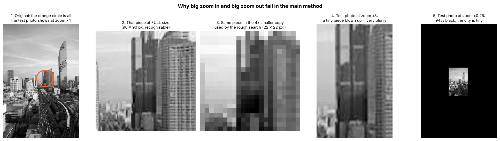
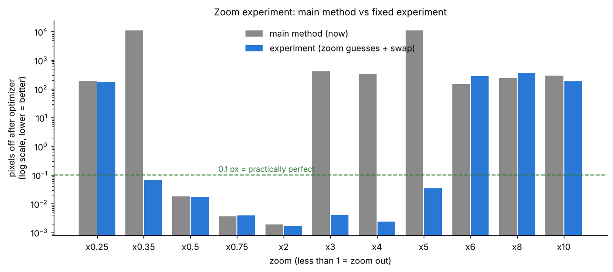

# Experiment: fixing big zoom in and zoom out

**This is a test only. The main method (`step4_find_shift.py`) was NOT changed.**
Run from the main folder: `python experiments/zoom_fix/zoom_fix_test.py` (~10–15 min).

## Why zoom fails in the main method (simple)

Example: you have a close-up photo of ONE building and must find it in a photo of the whole city.

1. **Big zoom in (×3 – ×5):** to be fast, the rough search first makes the city photo **4× smaller**.
   At zoom ×4 the building then becomes a tiny 22 × 22 blob (picture 3), while the test photo
   shows it big. Tiny blob vs big building → the rough search can't recognise it, so the right
   spot never gets onto the short list. (The exact full-size check WOULD recognise it.)
2. **Huge zoom in (×6 and more):** the test photo is a tiny piece of my small 418 × 625 photo,
   blown up → very blurry (picture 4). There is almost no detail left to match.
   A real camera zoom would show real detail, so this is partly a problem of my test photos.
3. **Big zoom out (×0.35 and less):** the test photo is mostly black with a tiny city in it
   (picture 5). The main method looks for the test photo's middle inside the original, but the
   test photo's middle is now black or a tiny blur.

## The two fixes tried here

- **Fix 1 – zoom guesses:** in the rough search, ALSO make the test photo 2×, 4× and 8× smaller
  than the original. One of these guesses makes the building about the same size in both,
  so the rough search can recognise it. Every guess adds spots to the short list; the exact
  full-size search picks the winner (as before).
- **Fix 2 – swap the photos:** zoom out = zoom in the other way round (the paper's 0.469 example
  is exactly this). So also look for the ORIGINAL inside the TEST photo, then turn the answer around.
- At the end: put each answer back and keep the one that REALLY matches best.

## Results (turn 40°, small move, zoom ×0.25 … ×10)

| Zoom | ×0.25 | ×0.35 | ×0.5 | ×0.75 | ×2 | ×3 | ×4 | ×5 | ×6 | ×8 | ×10 |
|---|---|---|---|---|---|---|---|---|---|---|---|
| Main method | ❌ | ❌ | ✅ | ✅ | ✅ | ❌ | ❌ | ❌ | ❌ | ❌ | ❌ |
| Experiment | ❌ | ✅ 0.069 | ✅ | ✅ | ✅ | ✅ 0.004 | ✅ 0.002 | ✅ 0.034 | ❌ | ❌ | ❌ |

- Main method: works **×0.5 – ×2** here (×3 worked in test C1 with a 300° turn, but not here).
- Experiment: works **×0.35 – ×5** – now like the paper ("in practice up to ×4").
- Still fails: ×0.25 (city too tiny) and ×6+ (test photo too blurry – would need a bigger photo).
- Price: ~60 s per test instead of ~10–20 s (cloud computer), because it searches
  4 zoom guesses × 2 anchors × 2 directions.

Numbers: `zoom_fix_results.json`.
